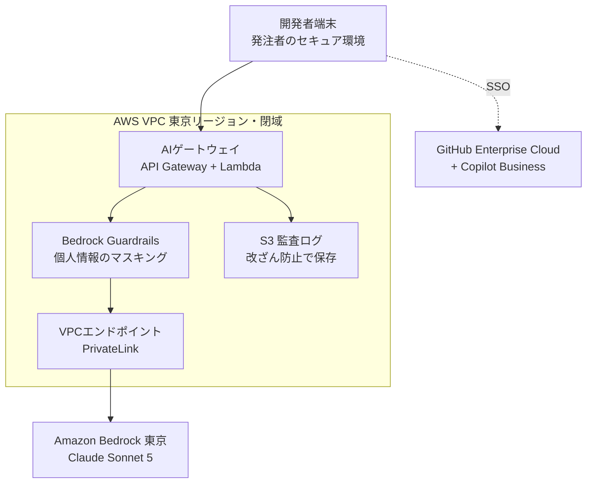

## はじめに

「AIを開発に使いたい。でも、いくらかかるのか説明できない」。
受託開発の現場では、この壁で止まることがよくあります。
この記事では、AI開発環境の費用を **工程ごとに** 見積もる方法を、具体的な金額つきで解説します。

題材は、決済系のようなミッションクリティカルな大規模システムの改修です。
個人情報や金額を扱うので、セキュリティの要求がとても厳しい領域です。
そのぶん、ここで通用する考え方は、ほかの多くの案件にもそのまま使えます。

この記事で分かることは次の4つです。

- 情報を外に出さないAI開発環境の構成
- 工程ごとに、どのAIツールを何のために使うか
- 工程別の見積金額と、その計算方法
- 受託ならではの契約・見積書の注意点

:::message
金額は2026年10月時点の公開価格をもとにした試算です。実在の案件の数値ではありません。為替や使用量で変わるので、正式な見積の前に各社の料金ページを確認してください。
:::

## 前提：なぜ「工程別」に見積もるのか

受託開発では、要件定義だけ、実装だけ、のように工程単位で受注することがよくあります。
工程が変われば、人数も、期間も、AIの使い方も変わります。
それなのにAI費用を「全員分×全期間」で見積もると、金額がふくらんで通りません。

たとえば、20名が6か月間、全員Claude Codeと仮想デスクトップを使う前提で計算すると、総額は1,000万円を超えます。
しかし実際には、全員がClaude Codeを常用するのは実装工程だけです。
要件定義の4名にCopilotやコードスキャンの契約は要りません。

そこでこの記事では、次の前提で工程ごとに計算します。

| 項目 | 前提 |
|---|---|
| 為替 | 1ドル＝150円 |
| 人月単価 | 120万円 |
| 端末 | 発注者のセキュア環境（VDIなど）を使う |
| クラウド | AWS東京リージョン |

## 全体の構成：AIへの入口は1本にする

まず、どの工程でも共通の構成を決めます。
ポイントは **AIへの入口をゲートウェイ1本に絞る** ことです。
入口が1本なら、個人情報のマスキングも、ログの保存も、そこで一括してできます。



それぞれの役割は次のとおりです。

| 部品 | 役割 |
|---|---|
| AIゲートウェイ | 認証し、誰が使ったかを記録する |
| Bedrock Guardrails | プロンプトと応答から個人情報を検出し、マスクする |
| S3 監査ログ | 全プロンプトと応答を保存する。監査で「誰が何を入力したか」を追える |
| PrivateLink | Bedrockへの通信をインターネットに出さない |
| Amazon Bedrock | Claudeを動かす。入力は学習に使われない |
| GitHub + Copilot | ソース管理と、IDEでのコード補完 |

Claude CodeはBedrock経由で動かせます。
環境変数 `CLAUDE_CODE_USE_BEDROCK=1` を設定し、エンドポイントをゲートウェイに向けます。
これで、エージェントの通信もすべて同じ入口を通ります。

## 工程ごとのAIの使い方

次に、工程ごとに「AIに何をさせるか」と「人間がどこで止めるか」を決めます。
AIの出力は、どの工程でも **下書き** として扱います。
最後に承認するのは必ず人間です。

| 工程 | 使うツール | AIにさせること | 人間の関門 |
|---|---|---|---|
| 要件定義 | 社内チャット（Bedrock） | 議事録から要件一覧を作り、矛盾と曖昧な点を洗い出す | 業務担当者が要件一覧を確認して合意 |
| 設計 | Claude Code、Markdown + Mermaid | 設計書のたたき台と、要件との対応表を作る | 設計レビューをPRで行う |
| 実装・単体テスト | Copilot、Claude Code | 周辺機能の実装と、境界値を網羅したテストの生成 | 金額計算などコア部分は人が書き、2名承認 |
| 結合・総合テスト | 社内チャット、Copilot | テストシナリオの表と合成テストデータを作る | 本番データは使わない |
| 運用保守 | ゲートウェイ経由のBedrock | マスク済みログの一次分析、古いコードの読解 | 本番変更は既存の変更管理を通す |

「コア部分は人が書く」という線引きは、とても大事です。
金額計算、残高、精算のように、間違えるとお金が動く処理です。
ここではAIを補助にとどめ、レビューとテストを従来以上に厚くします。

## 単価を確認する

見積に使う単価は次のとおりです（2026年10月時点）。

| サービス | 単価 | 備考 |
|---|---|---|
| Claude Sonnet 5（Bedrock） | 入力 $3／出力 $15（100万トークンあたり） | 2026年8月末までの導入価格は終了 |
| Bedrock Guardrails（個人情報フィルタ） | $0.10／1,000テキスト単位 | 1単位は最大1,000文字 |
| GitHub Enterprise Cloud | $21／人・月 | |
| GitHub Copilot Business | $19／人・月 | 2026年6月から利用分はAIクレジット課金 |
| GitHub Code Security | $30／アクティブなコミッター・月 | CodeQLによる脆弱性検出 |
| GitHub Secret Protection | $19／アクティブなコミッター・月 | 鍵の混入をpush時に止める |

Bedrockは使った分だけ課金されるので、1人あたりの使用量を仮定します。
今回は工程ごとに次のように置きました。

| 工程 | Bedrockの想定（1人・月） | 根拠 |
|---|---|---|
| 要件定義 | $25 | チャットで議事録を整理する程度 |
| 設計 | $60 | Claude Codeで設計書を読み書きする |
| 実装・単体テスト | $108 | Claude Codeを毎日使う。1日あたり入力150万・出力6万トークン×20日 |
| 結合・総合テスト | $50 | シナリオとテストデータの生成 |
| 運用保守 | $40 | ログ分析とコード読解 |

実装工程の$108は、次の計算です。

```text
入力：150万トークン × 20日 = 3,000万トークン → 30 × $3  = $90
出力：  6万トークン × 20日 =   120万トークン → 1.2 × $15 = $18
合計：$108
```

プロンプトキャッシュが効けば、入力側はもっと下がります。
ただ、見積は高めに置いておく方が安全です。

## 工程別の見積

ここまでの単価と使用量から、工程ごとの月額を出します。
契約するツールは、その工程で必要なものだけです。

| ツール（月額・ドル） | 要件定義 | 設計 | 実装・単テ | 結合・総合 | 保守 |
|---|---:|---:|---:|---:|---:|
| 体制 | 4名×2か月 | 6名×3か月 | 15名×4か月 | 8名×3か月 | 3名×12か月 |
| Bedrock | 100 | 360 | 1,620 | 400 | 120 |
| ゲートウェイ・ログ | 100 | 150 | 250 | 150 | 100 |
| Guardrails | 10 | 10 | 50 | 20 | 30 |
| GitHub Enterprise Cloud | 84 | 126 | 315 | 168 | 63 |
| Copilot Business | − | − | 285 | 152 | 57 |
| Code Security | − | − | 450 | − | − |
| Secret Protection | − | − | 285 | − | 57 |
| **月額合計** | **294** | **646** | **3,255** | **890** | **427** |

これに初期構築費を足します。
初期構築は、ゲートウェイの構築、利用ルールの整備、メンバーへの説明です。
実装工程だけはCI（CodeQLやカバレッジチェック）の整備も入るので多めにしています。

| 工程 | ランニング（期間分） | 初期構築 | 合計 | 工程の人件費 | 割合 |
|---|---:|---:|---:|---:|---:|
| 要件定義 | 88,200円 | 600,000円（0.5人月） | **688,200円** | 960万円 | 7.2% |
| 設計 | 290,700円 | 600,000円（0.5人月） | **890,700円** | 2,160万円 | 4.1% |
| 実装・単体テスト | 1,953,000円 | 1,800,000円（1.5人月） | **3,753,000円** | 7,200万円 | 5.2% |
| 結合・総合テスト | 400,500円 | 600,000円（0.5人月） | **1,000,500円** | 2,880万円 | 3.5% |
| 運用保守 | 768,600円 | 600,000円（0.5人月） | **1,368,600円** | 4,320万円 | 3.2% |

一番右の「割合」は、AI費用÷その工程の人件費です。
これは **元を取るのに必要な工数削減率** の目安になります。
どの工程も、3〜7%の効率化で回収できる計算です。

## 見積から分かる2つのこと

### 1. 小さい工程は初期費用がほとんど

要件定義の合計68.8万円のうち、60万円は初期構築です。
設計やテストでも、総額の6〜9割を初期構築が占めます。
つまり、ランニングを削るより、初期構築をどう減らすかの方が効きます。

### 2. 連続して受注すると大きく下がる

工程を別々に受注すると、毎回ゲートウェイを作り直すことになります。
同じ会社が続けて受注すれば、最初に作った環境を使い回せます。

| 受注の仕方 | 初期構築 | 総額 |
|---|---:|---:|
| 工程ごとに別々 | 3.5人月 | 7,701,000円 |
| 全工程を連続 | 2.25人月 | 6,201,000円 |

差は約150万円です。
提案のときに「連続して任せてもらえれば、この分が安くなります」と言える材料になります。

## コストを下げる5つの方法

1. **初期構築を使い回す。** 上の表のとおり、連続受注なら約150万円下がります。
2. **端末は発注者のものを使う。** 自前でVDIを用意すると、1人月あたり約1.5万円かかります。
3. **チャット用途は小型モデルにする。** 議事録整理やテストシナリオ作成なら、Haikuのような小型モデルで足ります。単価はSonnetの約3分の1です。
4. **セキュリティ機能は実装工程だけ契約する。** Code SecurityとSecret Protectionはコミッター単位の課金です。コードを書かない工程では不要です。
5. **使用量に天井を作る。** AWS BudgetsでBedrockの月額上限を決めます。Copilotも組織の予算上限を設定できます。

## 受託ならではの注意

### 発注者の承諾を先に取る

一番大事なのはここです。
AIを使う前提の見積は、発注者から書面で承諾をもらってから出します。
決済系では、無断でAIを使うと契約違反になり得ます。

契約書か覚書には、少なくとも次を書きます。

- AIを使ってよい工程と作業
- 入力してよいデータ、いけないデータ
- 使うサービスと、データの保存場所（例：AWS東京リージョン）
- ログの保存期間と、監査のときの提出方法

### 見積書には経費として分けて載せる

AI費用は、人月単価に混ぜずに分けて載せるのがおすすめです。

```text
AI開発環境構築費　　　一式　　　600,000円
AI開発環境利用料　　　月額　　　 44,100円 × 2か月
```

人月単価に含めてしまうと、「AIで早くなったなら人月を減らして」と値引きを求められやすくなります。
分けて載せれば、発注者も費用と効果を比べやすくなります。

### 責任は受注側に残る

AIが書いたコードでも、契約不適合責任を負うのは受注側です。
「AIで速くなったから」とレビューやテストの工数まで削るのは危険です。
削ってよいのは作る工数で、確かめる工数ではありません。

### 前工程の成果物を確認する

工程単位で受ける場合、前工程の成果物を引き継ぎます。
設計書がWordやExcelだと、AIが読みにくく効果が落ちます。
受け入れのときにMarkdownへ変換する工数（数人日）を見積に入れておきましょう。

## よくある失敗

**全員分×全期間で見積もってしまう。**
金額が大きくなり、検討の段階で止まります。
工程ごとに人数とツールを分けて計算しましょう。

**ゲートウェイを後回しにする。**
「とりあえず各自で使ってみて」と始めると、個人アカウントでの利用が広がります。
あとから入口を1本にまとめるのは大変なので、最初に作ります。

**Bedrockの上限を設定しない。**
エージェントは、ループに入ると大量のトークンを使うことがあります。
受託は赤字にできないので、予算アラートと上限は必須です。

**効果を先に値引きしてしまう。**
効果が出る前に「AIで2割安くします」と約束すると、出なかったときに赤字になります。
まずはパイロットで効果を測り、その数字で次の見積を作りましょう。

**本番データでテストしてしまう。**
「マスクすれば大丈夫」と本番データを持ち込むのは避けます。
AIに合成テストデータを作らせる方が安全で、境界値も網羅しやすいです。

## 自分の案件で見積もる手順

1. **工程と体制を書き出す。** 工程ごとの人数と期間を表にします。
2. **工程ごとに使うツールを決める。** コードを書かない工程からはCopilotとセキュリティ機能を外します。
3. **Bedrockの使用量を仮定する。** 1人・1日あたりの入出力トークンを置き、月額に直します。
4. **初期構築の人月を見積もる。** ゲートウェイ、ルール整備、説明会を工程ごとに足します。
5. **人件費に対する割合を出す。** AI費用÷人件費で、必要な効率化の目安を出します。
6. **連続受注の場合も計算する。** 初期構築を使い回した場合の金額を並べて提案します。

## まとめ

- AIへの入口はゲートウェイ1本にし、閉域で使う
- AIの出力は下書き扱いにし、コア部分は人が書いて人が承認する
- 工程ごとに人数とツールを分けて見積もれば、AI費用は工程費の3〜7%に収まる
- 小さい工程は初期構築費が大半なので、連続受注で使い回すと安くなる
- 受託では、発注者の書面承諾と、見積書での費用の分け方が大事

「AIはお金がかかる」と思われがちですが、工程に合わせて分解すると、意外と小さな金額になります。
まずは一つの工程で見積を作ってみてください。

## 参考

- [Amazon Bedrock 料金](https://aws.amazon.com/bedrock/pricing/)
- [Claude 料金（Anthropic）](https://platform.claude.com/docs/en/about-claude/pricing)
- [GitHub Copilot Business の料金と課金方式](https://its.umich.edu/communication/collaboration/github/copilot)
- [GitHub Code Security / Secret Protection の料金](https://sdtimes.com/security/github-unbundling-its-github-advanced-security-offering-starting-in-april/)
- [Bedrock Guardrails の料金](https://www.cipherprojects.com/blog/posts/bedrock-guardrails-production-guide-2026/)
