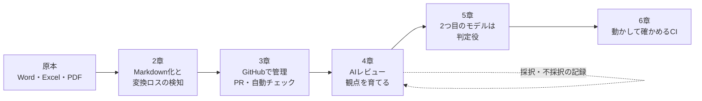

AIに設計書やコードを見せて「レビューして」と頼むと、指摘がたくさん返ってきます。最初は頼もしく感じます。ところが、使い続けると困りごとが出てきます。

- 的外れな指摘が混ざり、毎回人が弾いている
- 同じ的外れな指摘を、次のレビューでもまた出してくる
- 指摘は多いのに、本当に危ないところは素通りしている

これは、AIの性能だけの問題ではありません。**AIに何を読ませ、何に照らして見させ、結果をどう扱うか**が決まっていないことが原因です。この本では、その「決まっていない部分」を一つずつ仕組みにしていきます。

## この本で作る流れ

この本で扱うのは、次の5つの段階です。

| 章 | 解決すること |
| --- | --- |
| 2章 Markdown化 | AIが読む資料が、変換の途中で欠けていないかを確かめる |
| 3章 Docs as Code | ドキュメントの変更を、PRと自動チェックで管理する |
| 4章 観点を育てる | 的外れな指摘を、記録をもとに減らしていく |
| 5章 判定役のモデル | 複数のモデルを、人の手間を増やさずに使う |
| 6章 動かして確かめる | AIが書いたテストで拾えない不具合を、CIで拾う |
| 7章 導入の順番 | 小さく始めて、どの順で広げるかを決める |

前半（2〜3章）は、AIに渡す「入力」を整える話です。後半（4〜6章）は、AIの「出力」をどう確かめ、どう次に生かすかの話です。

## なぜ「入力」から始めるのか

AIレビューの精度を上げようとすると、まずプロンプトを工夫したくなります。でも、プロンプトより先に効くのは入力です。

設計書の表が変換の途中で1行抜けていたら、どんなに良いプロンプトでも、AIはその行を前提にレビューできません。それどころか、抜けた部分を推測で埋めて、もっともらしい指摘を作ってしまいます。

モデルの外側にある、こうした入力・手順・確認の仕組みをまとめて「ハーネス」と呼びます。この本は、AIレビューのためのハーネスづくりの本だと言えます。

## 対象読者

次のような方を想定しています。

- 設計書やコードのレビューに、AIを使い始めた方
- AIのレビュー結果を「なんとなく」使っていて、精度や手間に悩んでいる方
- チームにAIレビューを入れたいが、どこから仕組みにすればよいか迷っている方

GitやGitHubのPRを使ったことがあれば、読み進められます。GitHub Actionsは使ったことがなくても大丈夫です。3章で、最初の設定から説明します。

## この本で使うもの

各章の仕組みは、公開リポジトリで実際に動かしています。

| 章 | リポジトリ |
| --- | --- |
| 2章 | [doc-to-markdown](https://github.com/shoyo-maya-bot/doc-to-markdown)（コマンド名 `doc2md`） |
| 3章 | [zenn-articles](https://github.com/shoyo-maya-bot/zenn-articles)（この本自体を管理しているリポジトリ） |
| 4章 | [office-review](https://github.com/shoyo-maya-bot/office-review) |
| 5章 | [agent-lab](https://github.com/shoyo-maya-bot/agent-lab) の `auto-review` |
| 6章 | [shoyo-maya-bot](https://github.com/shoyo-maya-bot) のツール群 |

AIのツールは、主にGitHub CopilotとClaude Codeを使います。考え方はツールに依存しないので、ほかのAIエージェントでも同じように使えます。

:::message
サンプルの設計書・観点・データは、すべて架空のものです。特定の企業や案件の内容は含んでいません。
:::

## 読み方

章の順番どおりに読むと、全体の流れがつかめます。ただ、困っていることがはっきりしているなら、その章から読んでも大丈夫です。

- 「AIの指摘が的外れで困る」→ 4章から
- 「複数のモデルを使い分けたい」「費用が気になる」→ 5章から
- 「AIに書かせたコードが本番で動かない」→ 6章から

どの章も「仕組み → 手順 → よくある失敗」の順で書いています。最後の「よくある失敗」だけ先に読んで、自分に当てはまるものを探すのもおすすめです。

## この本の約束

最後に、この本を通して大事にしている考え方を3つ挙げます。

1. **AIの出力は下書き。** 採否は人が決めます。AIの指摘をそのままCIの合否にはしません。
2. **機械で分かることは機械に。** 書式・必須項目・件数のように白黒つくものは、AIより先にスクリプトで確かめます。
3. **作り手と採点役を分ける。** AIが作ったものを、同じAIだけで確かめない。この本でいちばん繰り返す教訓です。

では、AIに渡す資料を整えるところから始めましょう。
