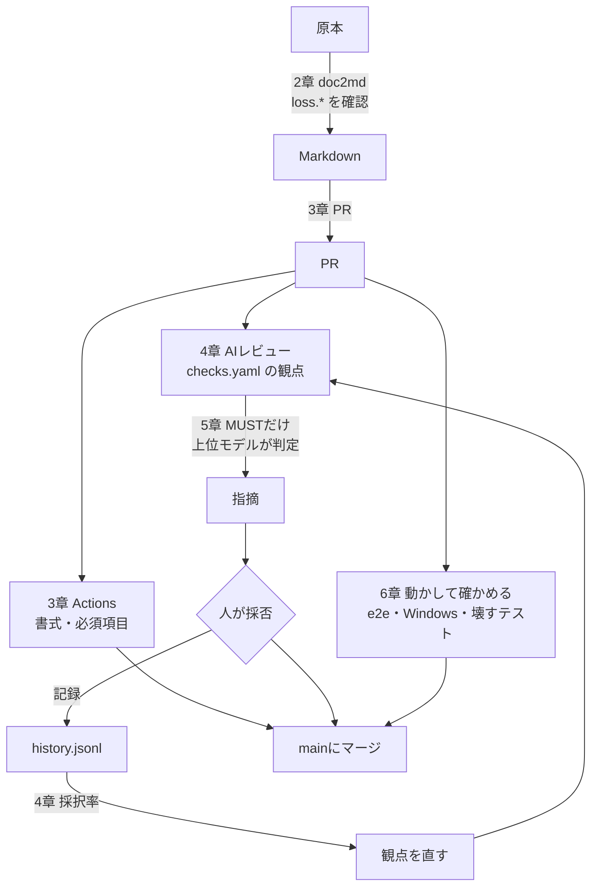

ここまで、AIレビューを仕組みにするための5つの段階を見てきました。最後に、これをどの順番で入れていけばよいかをまとめます。

全部を一度に入れる必要はありません。むしろ、一度に入れると失敗します。仕組みが増えるほど、どこで問題が起きているのかが分かりにくくなるからです。

## 全体をもう一度見る

この本で作った流れを、1枚にまとめるとこうなります。

入力を整える（2〜3章）、AIに見させる（4〜5章）、動かして確かめる（6章）。そして、人の判定を記録して観点に戻す。この輪が回っていることが、「仕組みになっている」状態です。

## 導入の順番

おすすめの順番は次のとおりです。各段階で「次に進む目安」を満たしてから進みましょう。

| 段階 | やること | 次に進む目安 |
| --- | --- | --- |
| 1 | 設計書を1種類だけ、10〜20件Markdownにする（2章） | `loss.*` の警告を全件確認し、原本との突き合わせが終わった |
| 2 | そのMarkdownをリポジトリに置き、PRとlintを回す（3章） | 何回かのPRで、チェックが通ってからマージする流れが定着した |
| 3 | 一般的な観点で、AIレビューを始める（4章） | 採否を毎回記録できている |
| 4 | 採択率を見て、観点を直す（4章） | 主な観点で、5件以上の判定がたまった |
| 5 | 費用と精度を見て、モデルの使い方を決める（5章） | 自分たちのPRで、MUSTが出る割合を測った |
| 6 | 利用者の環境で動かすCIを足す（6章） | 「動かしていないところ」の一覧を作り、優先度を付けた |

ポイントは、**1種類の文書で最後まで通してから、種類を増やす**ことです。API定義書で1〜4を回してから、バッチ定義書に広げる。こうすると、仕組みの問題と文書の問題を切り分けられます。

## 段階ごとのつまずきやすいところ

### 段階1〜2：入力づくり

いちばん時間がかかるのは、原本との突き合わせです。ここを省くと、後のAIレビューがすべて信用できなくなります。表と文章が中心の文書から始め、図が中心の文書は後に回しましょう。

### 段階3〜4：観点づくり

最初から完璧な観点を作ろうとしないことです。一般的な観点で始めて、不採択の記録から `invalid_when` を具体的にしていくほうが、早く良くなります。

不採択を記録しないと、何も育ちません。「違う」と思った指摘ほど、記録する価値があります。

### 段階5：モデルの使い方

まずは上位モデルで1回、から始めるのが無難です。振り分けや判定役は、自分たちのPRで数字を測ってから決めます。5章の実験は架空の課題での結果なので、そのまま当てはまるとは限りません。

### 段階6：動かして確かめる

「どこを動かしていないか」を洗い出すところから始めます。利用者のOS、本物のDB、途中で落ちる場面、同時に来る場面。一覧にして、壊れたときの影響が大きいものから足していきます。

## 導入チェックリスト

自分たちの状況を確かめるのに使ってください。

**入力**

- [ ] AIに読ませる設計書は、Markdownでリポジトリにある
- [ ] 変換ロスの警告を確認してから使っている
- [ ] 原本とMarkdownのどちらが正かが決まっている
- [ ] Markdownが古くなったことに気づける（ハッシュなど）

**仕組み**

- [ ] mainはPRとチェックが必須になっている
- [ ] 書式・必須項目は、AIより先に機械でチェックしている
- [ ] チェックが0件のとき、失敗になる

**AIレビュー**

- [ ] 観点が1つのファイルで管理され、IDが付いている
- [ ] 観点に「無効となるケース」が書かれている
- [ ] 根拠の無い指摘は出させず、情報が足りなければ質問にさせている
- [ ] 指摘ごとの採否が記録されている
- [ ] 採択率を見て、観点を見直している

**モデルと費用**

- [ ] 複数のモデルの指摘を、ただ足して見せていない
- [ ] 1PRあたりの費用の上限を決めている
- [ ] 出力が途中で切れたときと、指摘0件を区別できる

**確かめ方**

- [ ] AIの指摘はコメントだけで、CIの合否にしていない
- [ ] 利用者と同じ環境で動かすジョブがある
- [ ] 「途中で落ちる」「同時に来る」を、わざと起こすテストがある
- [ ] AIが作ったものを、別の目（別のAIか人）で確かめている

## 最後に

AIのモデルは、これからも速いペースで良くなっていきます。それでも、この本で扱った仕組みの価値は変わりません。

モデルが良くなっても、欠けた資料を渡せば推測で埋めます。観点があいまいなら、何でも指摘できてしまいます。動かしていないところは、誰も確かめていません。

AIの力を引き出すのは、モデルの外側にある仕組みです。この本の中から、まず1つ、自分の現場で試してみてください。小さく始めて、記録を取り、少しずつ育てていく。それが、AIレビューを使い続けるためのいちばんの近道です。
